<p align="center">
  
</p>

<h1 align="center">urban.bee</h1>

<p align="center">
  <strong>AI civic complaint triage. One photo in, a routed, prioritised work item out.</strong>
</p>

<p align="center">
  
  
  
  
  
</p>

<p align="center">
  Built for <strong>OFFGRID</strong>, problem statement 10: <em>AI Civic Complaint Triage</em>
</p>

---

## The problem

Civic complaints arrive through many channels with no fixed format. A single complaint can mention a damaged road, its rough location, how long it has been there, how dangerous it is and what infrastructure it affects. Turning that by hand into something a municipal department can act on is slow, so routing and response lag behind.

## What urban.bee does

A citizen takes a photo and taps **Send**. urban.bee reads the photo (plus an optional voice note in any language, or a typed note), works out **what** the problem is, **which department** owns it, **how urgent** it is, and **whether it has already been reported**. It then puts it on the city's live map, already routed and prioritised.

| For citizens (mobile app) | For the city (admin dashboard) |
|---|---|
| Report in three taps: photo, automatic location, send | Live map of every complaint, coloured by severity |
| In-app camera, or pick from the gallery (up to 4 photos) | City-wide and per-department stats, intake trend, priority mix |
| Hold-to-speak voice notes in any language | Complaint drawer: photos, voice note, transcript, AI review |
| Choose the place on a map instead of current location | "How this was sorted": every AI step with timing |
| Plain-language result: which team, how soon | Every merged duplicate and extension in one place |
| Follow progress: Sent → Seen → Being fixed → Fixed | Start work, mark fixed or not actionable; the citizen's app picks it up on its next refresh |


---

## App screens

<table>
  <tr>
    <td align="center" width="25%">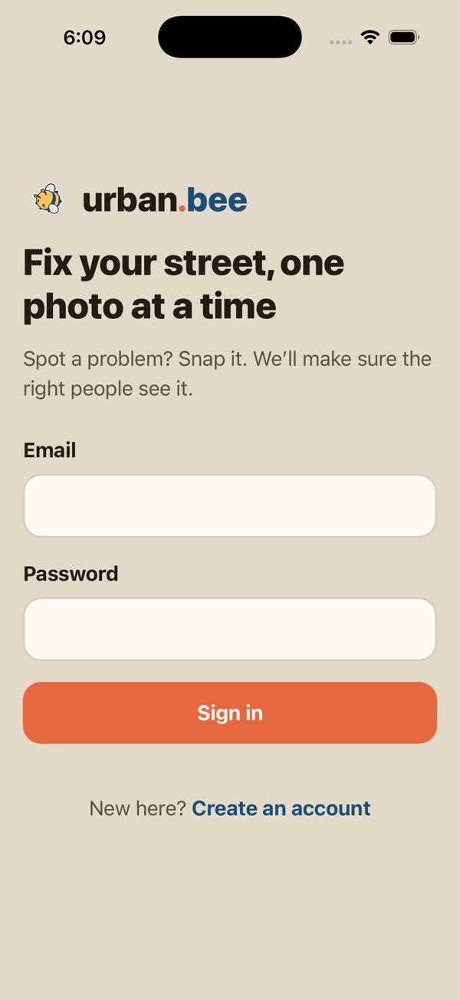<br /><sub>Sign in</sub></td>
    <td align="center" width="25%">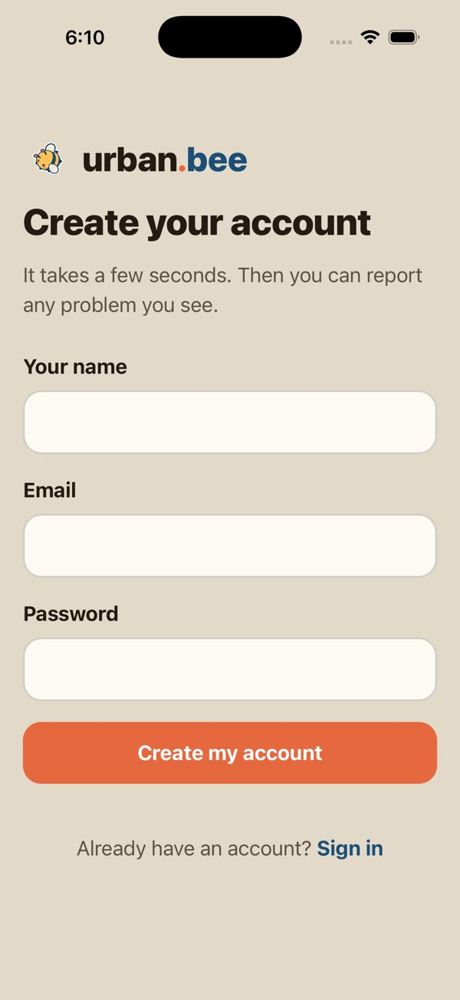<br /><sub>Create account</sub></td>
    <td align="center" width="25%">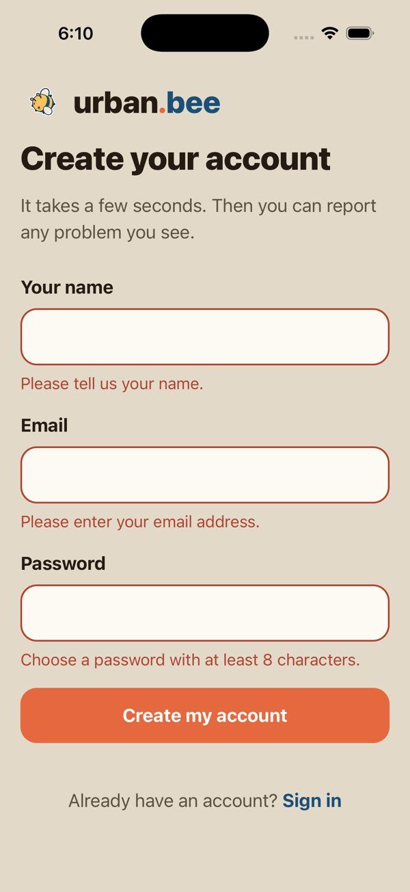<br /><sub>Form validation</sub></td>
    <td align="center" width="25%">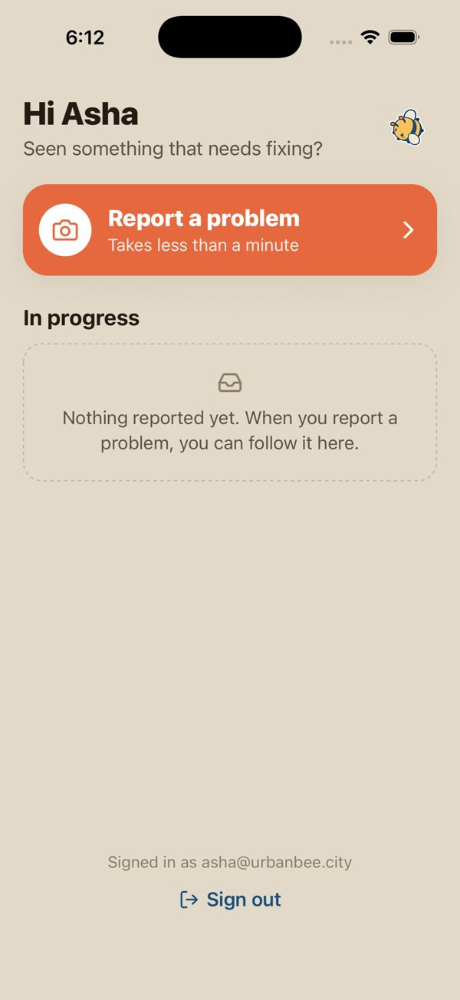<br /><sub>Home</sub></td>
  </tr>
  <tr>
    <td align="center" width="25%">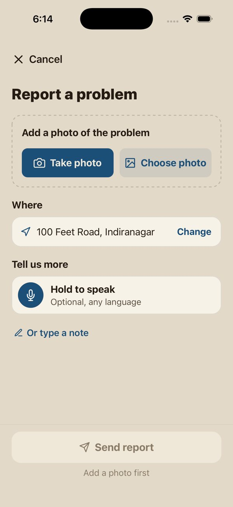<br /><sub>Report a problem</sub></td>
    <td align="center" width="25%">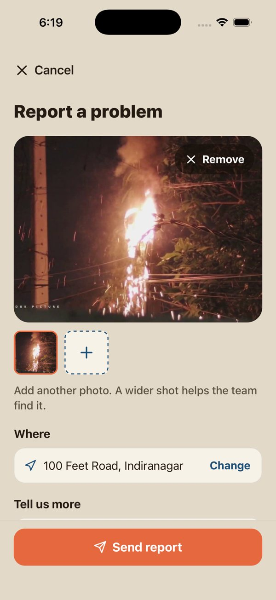<br /><sub>Photo added</sub></td>
    <td align="center" width="25%">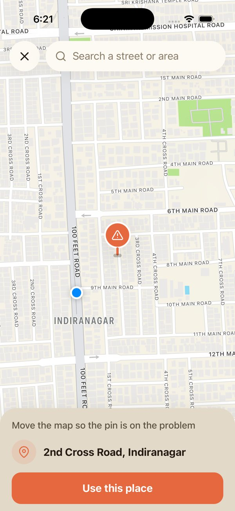<br /><sub>Choose the place on a map</sub></td>
    <td align="center" width="25%">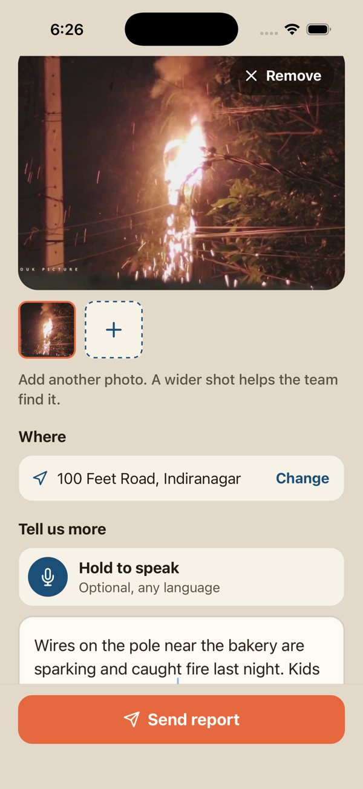<br /><sub>Add a note</sub></td>
  </tr>
  <tr>
    <td align="center" width="25%">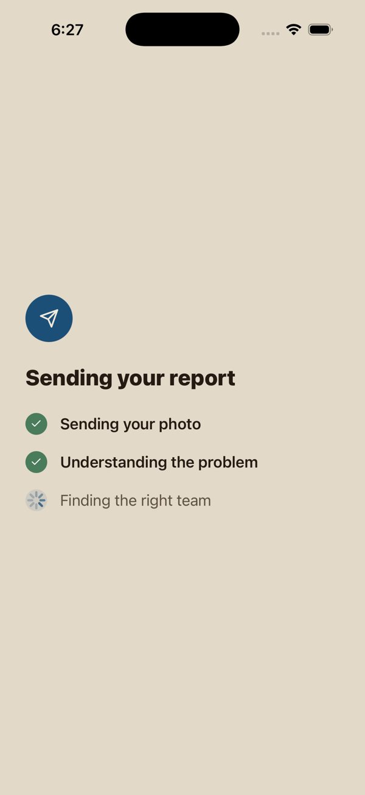<br /><sub>Sending</sub></td>
    <td align="center" width="25%">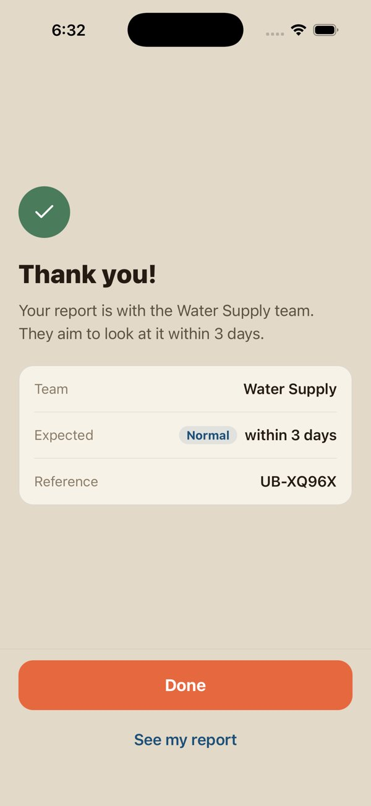<br /><sub>Routed to the right team</sub></td>
    <td align="center" width="25%">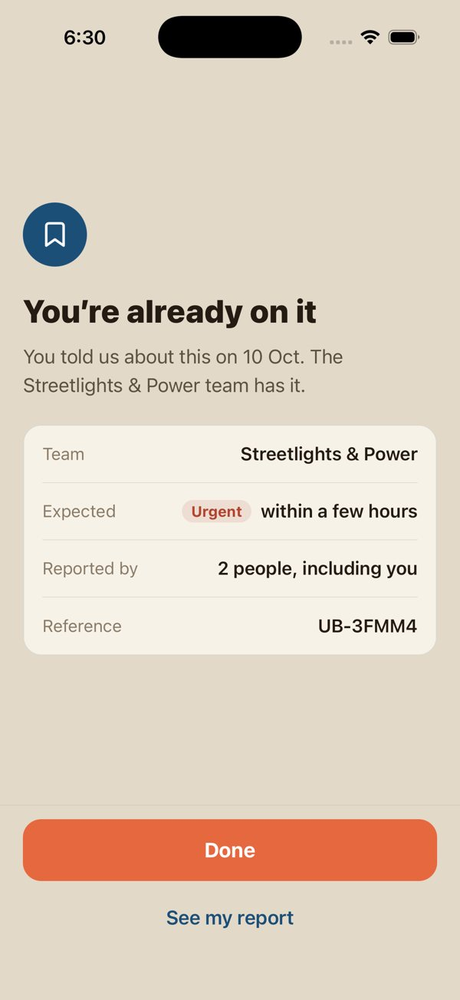<br /><sub>Duplicate detected</sub></td>
    <td align="center" width="25%">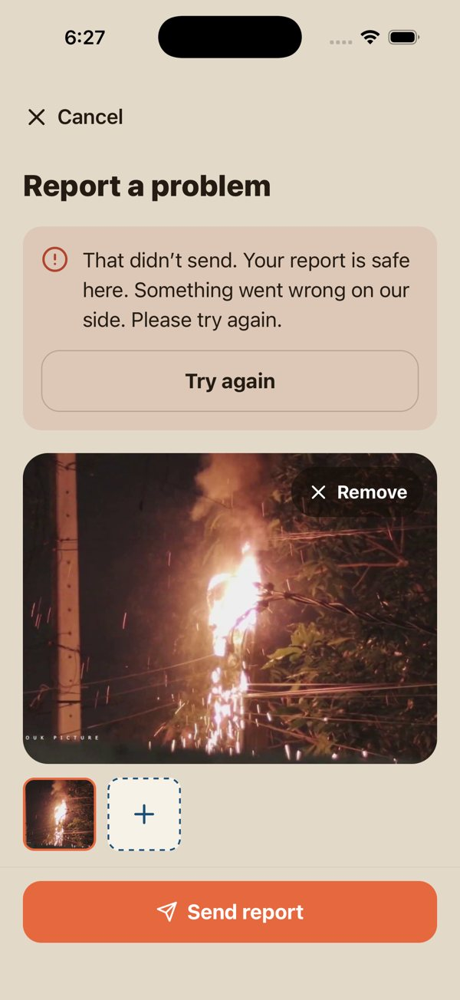<br /><sub>Send failed, nothing lost</sub></td>
  </tr>
  <tr>
    <td align="center" width="25%">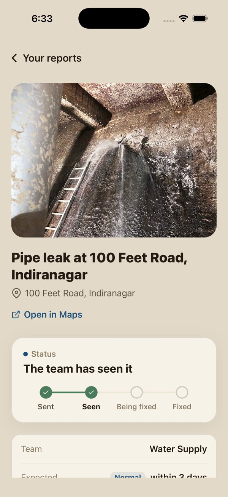<br /><sub>Status: seen</sub></td>
    <td align="center" width="25%">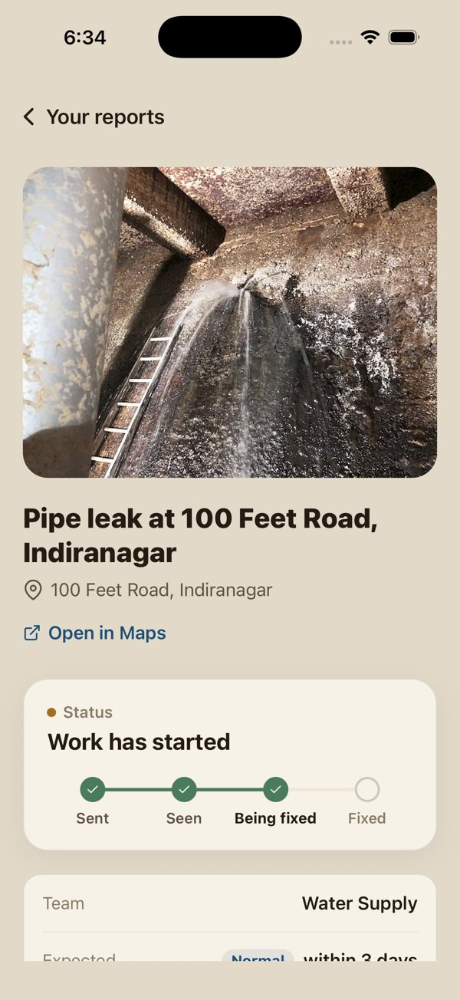<br /><sub>Status: being fixed</sub></td>
    <td align="center" width="25%"><br /><sub>Status: fixed</sub></td>
    <td align="center" width="25%">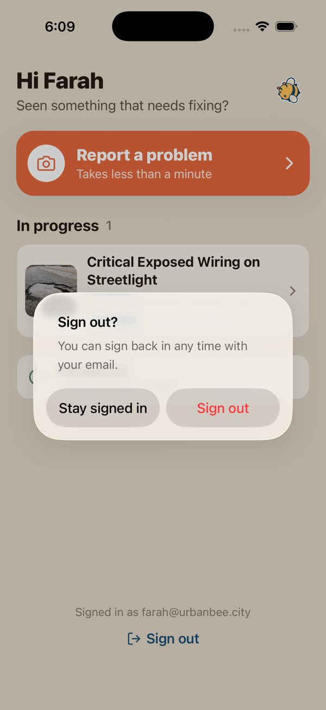<br /><sub>Sign out</sub></td>
  </tr>
</table>

---

## How a report is triaged

Every submission runs through a six-step pipeline on **Cloudflare Workers AI**. Each step has a timeout and a fallback, so a report is never lost when a model is slow or unavailable, and each step is recorded so admins can see exactly how a decision was made.

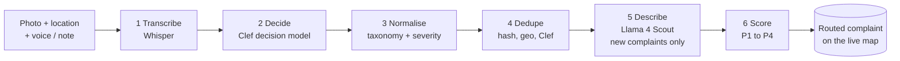

| Step | Model / logic | Output |
|---|---|---|
| Transcribe | `@cf/openai/whisper-large-v3-turbo` | Transcript and language of the voice note |
| Decide | `@cf/cloudflare/clef` | Department, category, severity, hazards, validity, each with probabilities |
| Normalise | Code | Taxonomy-valid labels, confidence, "needs review" flag |
| Dedupe | SHA-256 → haversine → Clef | New, merged, extension, or already reported |
| Describe | `@cf/meta/llama-4-scout-17b-16e-instruct` | Title, one-line summary, suggested action, tags (skipped when the report joins an existing complaint) |
| Score | Code | Priority score 0 to 100 and band P1 to P4 |

A **photo alone is enough**: every question is phrased so it can be answered from the image. If the AI is unavailable, a keyword rules classifier keeps the flow working. It reads the citizen's note and transcript (English keywords plus a few romanised words such as *gaddha*, *kachra* and *khatra*), and a report it can't match is filed as "Other" and flagged for an admin to review.

### Priority

```
base by severity:  low 15 · medium 35 · high 55 · critical 75
+12 risk to life · +6 blocks traffic · +6 affects many · +4 long standing
+4 per additional citizen reporting it (max +16)

P1 ≥ 80 (4 h) · P2 ≥ 60 (24 h) · P3 ≥ 35 (3 days) · P4 (7 days)
```

### Duplicate prevention

One real-world problem should be one complaint. Only **open** complaints from the last 30 days with the **same department and category** are candidates.

| Outcome | When | Effect |
|---|---|---|
| `created` | A genuinely new problem | New complaint |
| `merged` | Same photo, or Clef says "same problem" (≥ 0.75) within 25 m | Added as a supporting report, priority raised |
| `extended` | The problem continues further (road damage, flooding, garbage) within 60 m | Linked as an extension, affected area grows |
| `already_reported` | Same citizen, same problem | Nothing written, citizen told it is already on file |

A partial unique index in Postgres backs this up, so a race can't create a second report from the same account.

---

## Architecture

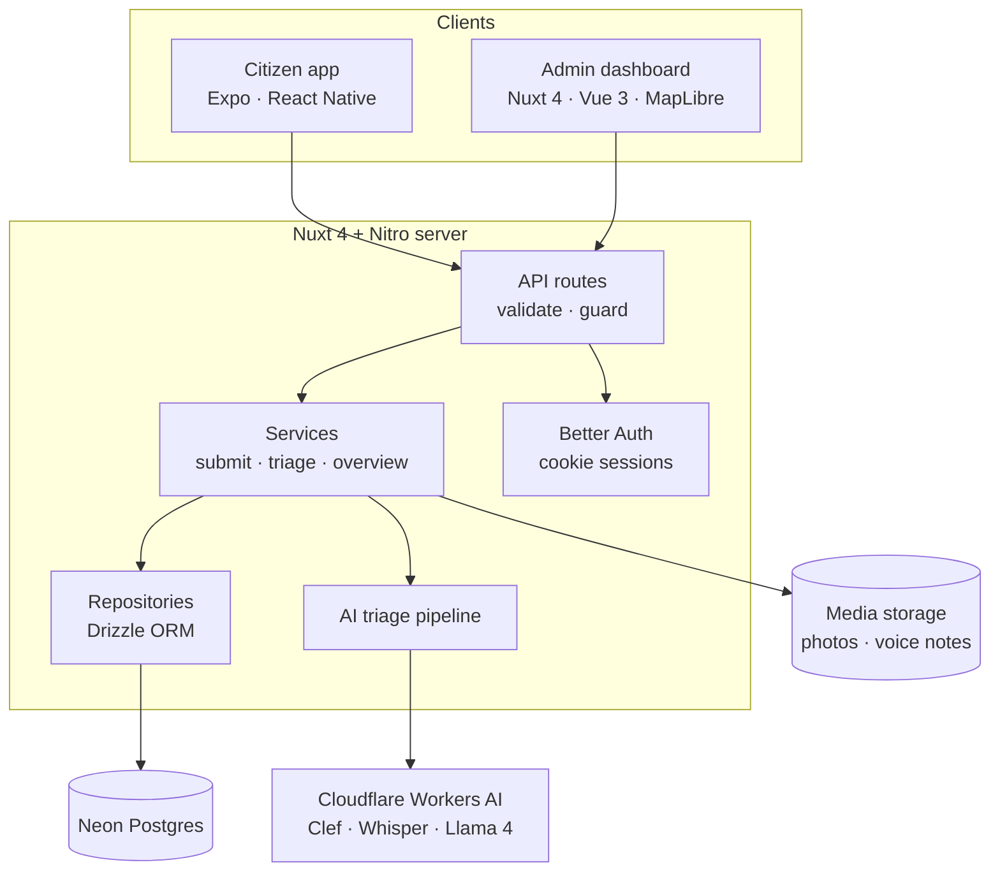

- **One backend** for both clients: route → service → repository → database.
- **One account system**: Better Auth with email and password. The app keeps its session cookie in SecureStore.
- **Provider isolation**: every model call goes through one Cloudflare client, so swapping a model is an env change.

## Tech stack

| Layer | Technology |
|---|---|
| Citizen app | Expo SDK 57, Expo Router, React Native, Reanimated, expo-camera, expo-audio, expo-location, react-native-maps |
| Admin dashboard | Nuxt 4, Vue 3, TypeScript, MapLibre GL (OpenFreeMap tiles), Lucide icons |
| Server | Nitro, Drizzle ORM, Better Auth |
| Database | Neon Postgres |
| AI | Cloudflare Workers AI: Clef, Whisper large v3 turbo, Llama 4 Scout |

## Repository layout

```
urban.bee/
├── app/                 Expo citizen app
│   └── src/
│       ├── app/         screens (home, report, camera, map picker, status, completed)
│       ├── components/  UI primitives and report components
│       ├── hooks/       photos, location, voice note, my reports
│       └── lib/         API client, auth client, plain-language copy
├── web/                 Nuxt dashboard and the backend for both clients
│   ├── app/             dashboard pages, components, composables
│   ├── server/          API routes, services, repositories, triage pipeline
│   ├── shared/          taxonomy, priority scoring, API types
│   └── scripts/         seed and reset scripts
└── docs/                logo and app screenshots
```

---

## Getting started

### Prerequisites

- Node.js 22+ and pnpm
- A [Neon](https://neon.tech) Postgres database
- A Cloudflare account with Workers AI (optional: without it the rules fallback is used)
- Xcode with the iOS Simulator, or Expo Go on a phone

### 1. Backend and dashboard

```bash
cd web
cp .env.example .env     # fill in DATABASE_URL, BETTER_AUTH_SECRET, Cloudflare keys
pnpm install
pnpm db:push             # create the tables
pnpm db:seed             # optional: demo accounts and complaints around Bengaluru
pnpm dev --host
```

The dashboard runs at <http://localhost:3000>.

### 2. Citizen app

```bash
cd app
cp .env.example .env     # EXPO_PUBLIC_API_URL=http://localhost:3000 for the Simulator
pnpm install
npx expo start           # press i for the iOS Simulator, or scan the QR code with Expo Go
```

On a real phone, set `EXPO_PUBLIC_API_URL` to your computer's Wi-Fi address, for example `http://192.168.1.20:3000`.

### Useful scripts (in `web/`)

| Command | What it does |
|---|---|
| `pnpm dev` | Dev server for the dashboard and API |
| `pnpm db:push` | Push the Drizzle schema to Neon |
| `pnpm db:seed` | Add demo accounts and complaints (`--reset` to start over) |
| `pnpm db:clear` | Remove every complaint and its media, keep accounts |
| `pnpm db:studio` | Open Drizzle Studio |

---

## Demo flow

1. **Dashboard overview**: live counts, intake chart, department table.
2. **Report from the app**: photo of a pothole, location fills itself, hold to speak a sentence, **Send**.
3. **Result in plain words**: "Your report is with the Roads team. This looks urgent."
4. **Dashboard map**: the new pin appears. Open it to see the photos, voice note, transcript, AI review and every pipeline step.
5. **Duplicates**: a second account reports the same pothole and it merges, raising the priority. The first account reporting it again is told it is already on file.
6. **Close the loop**: the admin starts work and marks it fixed, and the citizen's progress dots follow on the app's next refresh (every 30 seconds, or pull down).

---

<p align="center">
  Made with care for OFFGRID.
</p>
